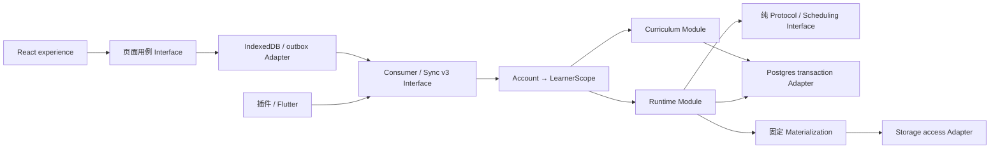

# M0-3：模块蓝图与迁移裁决

> 状态：设计定稿，迁移尚未执行；日期：2026-09-07
> 依赖：[消费合同](m0-3-consumer-contract.md)、[M0-2](m0-2-first-learning-state-spec.md)
> 本文不替代[生产路线图](production-migration-plan.md)，不创建第二条发布路线。

## 1. 当前代码审计与裁决

检查基于原工作树 `/Users/shadow/sensa-standalone`、checkpoint `5fee636e` 后的文档修改。
没有查询线上数据、执行数据库迁移或据此假设当前云端没有用户。

| 现有位置 | 代码证据 | M1 裁决 |
| --- | --- | --- |
| `apps/web/src/main.tsx` | RouterProvider进入experience/router；当前体验不由旧App/useSensaApp驱动 | 保留experience外壳/导航，生产数据接入这里；不恢复旧UI |
| `apps/web/src/experience/learningJourney/`、`learningRuntime/` | Prototype target、本机checkpoint、即时修复；缺服务器结果确认 | 保留视图与已确认行为；替换数据源/运行controller，原型adapter只留显式开发预览 |
| `apps/web/src/store.ts`、`sync.ts` | IndexedDB，v2 outbox，push→pull；终步另排encounter.complete；数据库按sense索引 | 复用持久化/收敛经验，不直接接入新Runtime；新v3 adapter独立分区和类型，禁止跨版本读写 |
| `apps/api/src/auth/principal.ts` | Cognito adapter返回501；local严格loopback；transport local/cognito | 新Supabase adapter，保留本机保护；生产不能fallback local；替换环境枚举和requestContext |
| `apps/api/src/app.ts`、`server.ts` | Hono Fetch app + Node serve；现有workspace路径；未挂新学习用例路由 | 复用Hono app工厂，抽出环境/依赖注入；新consumer路由不暴露workspace；Node与Edge仅入口不同 |
| `apps/api/src/database/core.ts` | pg.Pool，事务内set_config app.user_id/workspace_id | 保留事务scope机制；Edge使用适配连接池和TLS，单事务单连接，不分成多个无事务REST写 |
| `apps/api/src/sensa/planning/`、`encounter/` | old book/session/encounter pipeline，旧MemoryOutcome与按sense state | 保留legacy隔离；新Runtime/Planner按retention identity，不能把新动作伪装成旧Encounter |
| `apps/api/src/sensa/sync/operationLedger.ts` | 已有digest、账本和重放；mutable/fact双cursor | 复用算法经验，v3另立codec/账本/feed；不放宽v1/v2 parser接受新payload |
| `packages/contracts/src/sensa/learningConnection.ts` | v2 LearningTarget无retentionTargetId；RetentionTarget带learningTargetId | 保留公开领域v2，补明确SQL映射；不将表结构字段直接spread成合同 |
| `db/migrations/0010_sensa_learning_connection_v1.sql` | retention先建，learning_targets强制retention FK；general key，材料和个人来源表 | 增量兼容映射，保持历史FK；新canonical target映射与general默认scope见第3节 |
| `0008`、`0009` migrations | 表达/绑定registry；旧个人意义流程以Focus/Construction结构为主 | 0008复用不可变身份；0009保留历史；M2新增Context/occurrence/Inbox与直接接受路径，不虚构Focus |
| `packages/learning-kernel/src/runtime/scheduling.ts` | 已有FSRS算法及版本固定的adapter实现 | 复用算法，新增按RetentionTarget调度adapter与golden vectors；不重用旧boolean outcome压缩grade |
| `packages/contracts/src/sensa/lightweightLearningContent.ts`、`runtimeLearningRelease.ts` | 轻量内容与版本化release合同已存在 | 复用校验和固定材料；M1只读取已审核小样本，不调用实时LLM/TTS |
| `apps/api/src/sensa/media/local.ts`、`postgres.ts` | 本地媒体适配及数据库引用 | 开发保留；生产Supabase Storage private bucket+授权短链接，不能暴露文件根目录 |
| `apps/web-next`、既有smoke | mobile-form行为原型与确定性检查 | 保留参考/回归；不承诺迁移UI，不以smoke代替跨设备/公网验收 |

## 2. 全局 Module 与目录蓝图

既有领域总图裁决所有权。下列为实施目标目录，标“新增”的路径尚不存在，实施时按切片创建，
不提前创建空模块。公共类型由supervisor审定，一个worker依序实现，各模块内部helper自主。

```text
apps/web/src/experience/             保留UI/路由/展示组件
apps/web/src/application/            新增：页面用例controller、消费投影、状态映射
apps/web/src/data/consumer/          新增：HTTP client、supabase-session adapter
apps/web/src/data/replica/           新增：IndexedDB v3、outbox、material cache、sync engine
apps/api/src/app.ts                  Hono路由组合，依赖注入，无领域事务
apps/api/src/auth/                   Supabase principal + AccountSession/Access adapter
apps/api/src/sensa/access/           新增：账号/邀请/安装到LearnerScope
apps/api/src/sensa/curriculum/       新增：数量、成员、scope、声明、目标接纳
apps/api/src/sensa/runtime/          新增：Planner/Run/Step/活动/重学need/原子结算
apps/api/src/sensa/scheduling/       新增：RetentionTarget memory及handoff/outcome adapter
apps/api/src/sensa/sync/v3/          新增：验证、账本、feed、bootstrap、路由
apps/api/src/sensa/activity/         新增：签到与活动汇总，和学习Evidence隔离
apps/api/src/sensa/catalog/          复用registry/release，新增候选与materialization查询
apps/api/src/sensa/media/            Supabase Storage access adapter
packages/contracts/src/sensa/consumer/ 新增：envelope、query、command、projection、errors、schema
packages/learning-kernel/src/        纯协议/调度规则，禁止数据库/Auth/UI依赖
supabase/functions/sensa-api/        新增：Edge入口/依赖映射，调用同一应用factory
apps/api/src/server.ts               Node本机入口，调用同一应用factory
db/migrations/                      追加迁移，不重写0001–0010
apps/browser-extension/             M2新增：content script、background、浮层、独立replica
apps/flutter/                       后续客户端目标位置，M1不创建占位工程
```



Account、Catalog、Curriculum、Runtime、Scheduling、Sync、Media为M1具体模块；Semantic Intake、
Personal Content、Lexical Reference、Free Practice、Preferences、Data Control和全站统计遵循
领域已有边界，在M2/M3按用例接入。Stats/Projection只读学习事实；Account不能写学习进度；
媒体adapter不能改变固定材料；Sync调用同一用例事务，不维护第二套业务规则。

关键实际变化的seam：Node/Edge入口，local/Supabase Auth，local/Storage媒体，Web/Flutter
replica，各有明确两个adapter消费者；不为未来想象的多云引入通用云框架。

## 3. 持久化裁决与索引

下表为新DDL必须兑现的逻辑结构，确切索引名/辅助列由worker实现；主外键、唯一性、锁与
不变量不下放为自由选择。新增数据表保留兼容workspace_id，但只由服务器LearnerScope映射
填充；private schema不向Supabase anon/authenticated Data API暴露。

| 数据组 | 字段/约束和索引 | 事务所有者 |
| --- | --- | --- |
| Account binding | provider_identities(issuer,subject)唯一→account_id；Account/Learner一对一映射；account_sessions(provider_session_id)唯一、revoked_at；scope_epoch | Access；不能按邮箱合并历史学习者 |
| Invitation | account_id/受控邀请记录、status/revision；首次绑定验证已核验邮箱后绑定subject | Access；公开signup关闭，邀请不靠前端实现 |
| Installation/Replica | installation_id→account、replica_id→learner+installation+wire+epoch；旧installation不能改归属 | Access/Sync；bootstrap幂等 |
| Study Plan v3 | learner唯一、daily_new_limit、quantity_confirmed_at、revision、scope_revision、time_zone；独立于旧book-required study_plans | Curriculum；锁plan串行数量/开始 |
| Supplemental membership | membership_id、learner、retention_target_id、learning_target_id、status、ordinal、revision；当前(learner,target)唯一；provenance独立多行 | Curriculum；source去重不删个人Context |
| Target canonical mapping | retention_target_id→canonical_learning_target_id；唯一retention，FK同时校验learner/sense/binding；原learning_targets.retention_target_id继续作为历史版本关系 | Curriculum；同一事务创建/回填映射，API v2 snapshot取canonical映射，不任意取第一行 |
| Policy/Resolved Plan | assignment版本、target、purpose、readiness/reason、policy/protocol版本、materialization_id、revision；每target/purpose当前plan唯一 | Curriculum/Content；Run引用不可变版本 |
| Materialization | 复用0010表；schema/digest/provenance/validatorVersion及role索引；purpose/target/policy必须匹配 | Content；非validated不能ready |
| Daily start ledger | learner、account_date、retention_target_id、run_id、timezone revision，前3列唯一 | Runtime；仅创建initial Run扣额 |
| Protocol Run/Step | run_id、target/retention、purpose、policy commitment、materialization、status、revision；同retention一个active Run；step(run_id,ordinal)唯一 | Runtime；again新Step实例，不复用旧stepId |
| Activity/Run link | activity_id、learner、mode、revision、status active/paused/ended；引用run与进入时间；同learner当前active activity唯一 | Runtime；暂停/结束活动不终结Run |
| Attempt/Transition | attempt_id、run/step/ordinal、operation_id、raw action、版本、occurred_at、received_at；operation+action唯一，固定digest | Runtime；append-only，不存模型自由评分 |
| Completion/Handoff | completion每Run唯一；initial handoff每retention唯一；版本、basis和non_evidentiary明确 | Runtime/Scheduling同事务 |
| Retention memory | retention_target_id PK、FSRS数值/版本、revision、last_outcome_id；due索引(learner,due_at,target) | Scheduling；不再按senseId作为唯一记忆身份 |
| Review outcome/decision | due identity=(retention_target_id,memory_revision_at_open)唯一；decision的outcome/handoff引用唯一；完整grade/basis/evidenceLevel | Scheduling；两个unique防重复更新 |
| Relearning need | trigger_outcome唯一、retention、current_run、next_eligible_at、status、cycle/revision；eligible索引(learner,status,next_eligible_at) | Runtime；和长期FSRS due分开 |
| Offline grant | grant_id、run/installation/replica、epoch、版本/digest、issued/expires，签发记录可查 | Runtime/Access；本机不是grant issuer |
| Check-in | (learner,account_date)唯一、source/原操作/时区版本/发生与接收时间 | Activity；单独事务，不因失败回滚学习 |
| Operation ledger/feed | learner+operation_id唯一、wire/canonical version/digest/result；每learner feed head串行分配提交序号，索引(learner,sequence) | Sync调用领域同一事务；不能先写ack后写事实 |

默认retentionScopeKey沿用0010的`general`；v2 scope definition对应kind=default。首版不新增
independent scope。Sense/Binding版本更替保留同一retention身份；active Run继续引用旧固定
LearningTarget和Materialization，不为更新canonical指针重写历史。一个历史retention关联多个
LearningTarget时，根据明确当前版本/创建记录选择canonical；无法唯一裁决的记录隔离为
migration_conflict，不能取MIN(id)、最近时间或覆盖用户事实。

事务锁顺序固定：account/access状态读→learner plan→activity→retention（多目标按ID排序）→
run→memory→feed head。幂等占位与结果和事务一起提交；死锁/序列化失败由服务器有限重试
同一operation，不产生新ID，不把数据库重试显示成新的学习行为。client expectedRevision
依旧要校验，数据库重试不是自动接受过时输入。

## 4. 迁移路径与保护策略

**采用扩展→验证→切换→后续收缩。** 不改已应用迁移，不默认清库。编号按实施时最新序号
追加；建议按access、curriculum/target映射、runtime/scheduling、sync分批，避免一次巨大DDL。

1. 预检：核对迁移历史/实际schema，备份并在隔离数据库恢复；统计每旧表和学习者数量、旧
   outbox分布、target/retention映射歧义、孤立FK、非general scope及旧active Run。
2. 扩展：创建新v3表/约束/最小权限role；保留0008/0009/0010历史，补canonical mapping；
   M1新API只读新投影/写新运行，旧v1/v2只允许原legacy路径，不双写不同结果模型。
3. 内容：复制/校验必要已发布registry和小样本材料；缺stable绑定、版本或媒体的内容隔离，
   不用随机ID/默认Sense补齐；原始内容可复用，旧状态不能当已通过新validator。
4. 账号：默认新Supabase subject绑定新Account；需要接续旧账号时使用明确受控映射并审计。
   不能因email相同合并。没有已验证映射的旧学习者保留原样，只读历史。
5. 学习事实：旧Encounter/MemoryOutcome/按sense记忆维持legacy读模型，不自动转为轻量
   Study Completion或target FSRS。历史import需要独立可审计导入合同，不属于M1自动迁移。
   原型localStorage不能作为正式证据导入；可保留本机备份和只读体验记录。
6. 客户端：新IndexedDB名称带v3及account分区；旧数据库保留，旧未提交队列按原wire处理或
   隔离显示，绝不发到v3。bootstrap失败不删除旧库；原型预览与生产模式可辨别，不静默混合。
7. 切换：先受控测试账号验证v3；同一learner不可同时由旧/新写入正式学习。运行切换检查
   pending/active legacy状态，有未解决旧记录则禁止自动切换并给明确恢复入口。
8. 回退：代码回退时关闭新写入口，保留新表/feed/账本；可继续兼容v3或只读维护，不能让旧
   版本读新payload或用旧备份覆盖已接纳新事实。删除旧schema仅后续独立迁移处理。

开发测试数据可在独立临时数据库重建，由fixture manifest固定ID、版本与digest；不能把
“当前预计没有用户”作为删除原目录、云端或本机数据的依据。本次不执行上述迁移。

## 5. Supabase Edge 可行性与落地检查点

设计目标仍为Supabase优先：Postgres/Auth/Storage集中，Cloudflare静态前端，Resend SMTP。
当前Node入口不能原封不动部署：`@hono/node-server`、环境读取、workspace路径、pg全局池、
local media/file读取和monorepo `file:`依赖需要adapter或打包调整。Hono Fetch应用与纯kernel
是可复用基础，而不是“已验证Edge兼容”的证据。

官方文档核实（2026-09-07）：Edge支持npm/Node内建依赖；函数需自己的依赖配置。运行有
256MB内存、每请求2秒CPU等限制，异步IO等待与CPU计时不同；执行长任务不能依靠常驻进程。
连接短生命周期函数优先使用transaction pooler，不使用命名prepared statements或跨请求
session状态。现有set_config(...,true)必须与SQL留在同一事务/连接，不能切成逐请求REST。

参考：[依赖](https://supabase.com/docs/guides/functions/dependencies)、
[运行限制](https://supabase.com/docs/guides/functions/limits)、
[数据库连接](https://supabase.com/docs/guides/database/connecting-to-postgres)、
[JWT](https://supabase.com/docs/guides/auth/jwts)。SMTP由Auth调用Resend，不从Edge函数自行
开邮件端口；私有媒体链接由受限adapter签发，服务密钥只在服务端。

M1第一个切片必须完成无付费内容调用的Edge smoke：应用打包、Auth测试issuer、同事务两次
SQL及回滚、并发scope隔离、共享kernel、私有媒体授权、最大50条push/分页pull的CPU和连接
释放。测试数据不包含用户材料。若平台限制不通过，记录具体失败，复用同一consumer/API
和Postgres事务部署到独立Node托管；不改领域合同，也不为坚持“全套”拆散事务。

本阶段交付架构与适配清单，不宣称远端部署、认证投递或Edge运行已实测。M1先完成该检查点
再扩大集成；上线地区可达性、真实邮件送达和流量费用门属于M4，供应商价格随采购复核。
